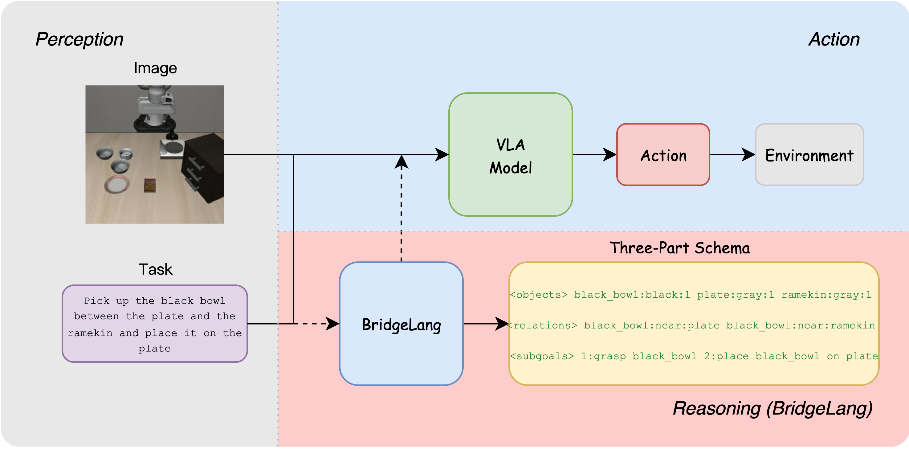

# BridgeLang

**Plug-and-Think: Structured Reasoning for Vision-Language-Action Models**

Kaikai Wei\*, Di Wen\*, Xinhai Li, Senwei Xiang&dagger;



BridgeLang is a lightweight, plug-and-play reasoning module that enhances pre-trained Vision-Language-Action (VLA) models through external structured reasoning — **without any VLA retraining or architectural modification**.

Given an image and a task instruction, BridgeLang generates a structured three-part schema (`<objects>`, `<relations>`, `<subgoals>`), from which semantically cleaned subgoals are extracted and appended to the original instruction. This "Plug-and-Think" process improves OpenVLA's average success rate on the LIBERO benchmark by **+5.45%** (up to +8.2%).

## Installation

```bash
git clone https://github.com/CliffKai/BridgeLang.git
cd BridgeLang
pip install -r requirements.txt
```

## Usage

### Single Inference (CLI)

```bash
python supplementor.py \
  --model Qwen/Qwen2.5-VL-3B-Instruct \
  --image /path/to/frame.png \
  --task "put the apple in the box"
```

### HTTP Server Mode

Start the server:

```bash
python supplementor.py \
  --model Qwen/Qwen2.5-VL-3B-Instruct \
  --server --host 127.0.0.1 --port 18081
```

Send a request:

```bash
curl -X POST http://127.0.0.1:18081/supplement \
  -H "Content-Type: application/json" \
  -d '{"task": "put the apple in the box", "image_path": "/path/to/frame.png"}'
```

Response:

```json
{
  "supplement": "<objects>apple:red:1; box:brown:1</objects> <relations>apple:near:box</relations> <subgoals>1:grasp apple; 2:place apple inside box</subgoals>",
  "elapsed_ms": 123
}
```

### Arguments

| Argument | Default | Description |
|----------|---------|-------------|
| `--model` | (required) | Path or HuggingFace ID of a Qwen2.5-VL model |
| `--image` | — | Path to input image (CLI mode) |
| `--image_b64` | — | Base64-encoded image (alternative to `--image`) |
| `--task` | — | Task instruction string (CLI mode) |
| `--server` | off | Launch as HTTP server |
| `--host` | 127.0.0.1 | Server bind address |
| `--port` | 18081 | Server port |
| `--device` | cuda | Inference device |
| `--dtype` | bfloat16 | Model precision (`bfloat16` or `float16`) |
| `--max_new_tokens` | 256 | Max generation length |
| `--temperature` | 0.0 | Sampling temperature (0 = greedy) |
| `--use_flash_attn2` | off | Enable Flash Attention 2 |

## Bridge-CoT Dataset

The Bridge-CoT dataset used to train BridgeLang is available on HuggingFace:

[https://huggingface.co/datasets/CliffKai/Bridge-CoT](https://huggingface.co/datasets/CliffKai/Bridge-CoT)

## Citation

```bibtex
@InProceedings{Wei_2026_CVPR,
    author    = {Wei, Kaikai and wen, Di and Li, Xinhai and Xiang, Senwei},
    title     = {Plug-and-Think: Structured Reasoning for Vision-Language-Action Models},
    booktitle = {Proceedings of the IEEE/CVF Conference on Computer Vision and Pattern Recognition (CVPR) Findings},
    month     = {June},
    year      = {2026},
    pages     = {3136-3145}
}
```

## License

This project is licensed under the [MIT License](LICENSE).
